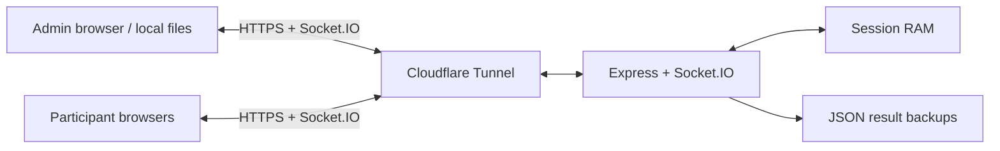

# 02 — Architecture and security

## Runtime topology

Phone browsers and admin browser connect to the same HTTPS public origin. Cloudflare Tunnel forwards HTTP and WebSocket traffic to a persistent Node process bound to 127.0.0.1:3000 on the existing server. Express serves static frontend and authentication endpoints; Socket.IO manages message transport. The admin browser alone holds the video File objects. All session and voting state lives in the single server process. Never use multiple workers or replicas. Cloudflare is transport, not application storage.



## Repository structure

```text
server.js
package.json
package-lock.json
.env.example
.gitignore
README.md
src/
  auth.js
  session.js
  socket.js
public/
  index.html
  admin.html
  css/common.css
  css/admin.css
  css/client.css
  js/admin.js
  js/client.js
  js/media.js
  js/leaderboard.js
data/results/.gitkeep
```

Use ES modules consistently. Browser modules via `<script type="module">`. Serve Socket.IO browser client from `/socket.io/socket.io.js`, no CDN. Only `express`, `socket.io`, `qrcode` dependencies. Native crypto, fs/promises, path, http, URL. `npm start` runs `node --env-file-if-exists=.env server.js` (Node 22+). Validate environment before listen; fail clearly if missing ADMIN_TOKEN or PUBLIC_URL. Default HOST=127.0.0.1 and PORT=3000. PUBLIC_URL must be an origin, no path or credentials; use http://localhost:3000 locally and https://reels.example.com in deployment. QR always generated from configured origin, never untrusted Host header. Do not expose source, env, specs, result files or node_modules through static middleware.

## HTTP contract

| Method/path | Behavior |
|---|---|
| GET / | Minimal join landing, explains QR required; optional paste join URL or UUID, never list active games |
| GET /join/:sessionId | Participant shell; client validates through socket join |
| GET /admin | Login or authenticated SPA; token entry if not authenticated |
| GET /admin/setup | Same admin shell, authenticated or show login |
| GET /admin/session/:id | Same admin shell, restores server state if authorized |
| GET /admin/session/:id/leaderboard | Same shell, server phase takes precedence |
| POST /api/admin/login | JSON {token}; 200 {ok:true} and session cookie or 401 |
| GET /api/admin/me | 200 {authenticated:true} or 401 |
| POST /api/admin/logout | Revoke auth and clear cookie |
| GET /api/admin/session | Current session snapshot or null; authenticated |
| GET /api/admin/session/:id/results | Authenticated JSON download of results |
| GET /health | 200 {ok:true}; no sensitive metadata |

No public session discovery endpoint. Return generic 404 for unknown routes. Set Cache-Control: no-store for auth/state/HTML responses. Set explicit reasonable request body limit (e.g. 64 KB); socket payload cap 64 KB; cap selected videos at 100, filename length at 180, token and IDs at validated lengths. Return safe JSON error codes, not stack traces.

## Authentication

Operator supplies strong random ADMIN_TOKEN, e.g. openssl rand -hex 32. Login compares token using native crypto timingSafeEqual with equal-length digest. Rate-limit login attempts (small in-memory per-IP buckets, bounded cleanup; do not blindly trust forwarded IP headers). Issue random 32-byte opaque admin credential in HttpOnly, SameSite=Strict, Path=/ cookie, Secure when PUBLIC_URL uses HTTPS, max age 8 hours. Store credential and expiry in process memory. Only one active admin credential is needed: new login revokes prior credential and disconnects old admin sockets. Logout also revokes sockets. Never expose token in URLs, JS, QR, logs or session data. No default secret. Do not project login before entering token; password-type field. Admin route secrecy is not authentication.

Socket.IO checks admin cookie at handshake, and rechecks live credential for every admin command. Participant socket cannot elevate via event payload. Allow same-origin browser requests only: compare Origin to PUBLIC_URL (allow explicitly configured local origin for local development, not wildcard); reject cross-origin unsafe HTTP requests and socket handshakes including WebSocket upgrades. Do not rely on CORS alone. Keep the public site same-origin. Use plain text insertion (`textContent`) for all filenames and untrusted messages, never HTML interpolation. Restrict CSP to self scripts/styles and blob/data for local media/previews as needed; no inline event handlers; avoid third-party assets. Add nosniff and frame-ancestors none. No new public application ports, no public SSH instructions. IP hiding is not a substitute for authentication; existing exposed services remain independently exposed.

## Module responsibilities

- `server.js`: read config, create Express and HTTP server, attach sockets, register routes, graceful shutdown; no game rules.
- `auth.js`: token comparison, auth issuance/revocation, middleware, origin validation, bounded login limiter.
- `session.js`: single game state, transition guards, deadlines, vote collection, aggregation, backups and snapshot serialization; no DOM or network-specific details.
- `socket.js`: validate message payloads, auth guards, membership, acknowledgments, broadcasts and disconnect/rejoin handling. Call engine functions, never replicate game rules.
- `admin.js`: routing via history, render phases, host interactions, socket state, auth and recovery.
- `media.js`: local file metadata, thumbnails, object URLs, playback; no backend calls.
- `leaderboard.js`: render ordered result rows and replay overlay, no independent scoring logic.
- `client.js`: parse join ID, anonymous token, connect/rejoin, render snapshot, submit vote and display acknowledgment.

## State and reliability boundaries

Server is authoritative for phase, round IDs, deadlines, count and results. Browser state is disposable except local media and anonymous voting token. Socket.IO reconnect is expected, but transport replay alone is insufficient: send current snapshot on every join. Node restart invalidates live session and login; no promise of resuming. Results are written to compact JSON after every terminal round and finish. Backup failure logs error and shows admin warning; it does not halt the event. On shutdown close timers, sockets and HTTP listener. Use one process under existing supervisor or foreground shell/tmux for rehearsal. No scaling infrastructure.
