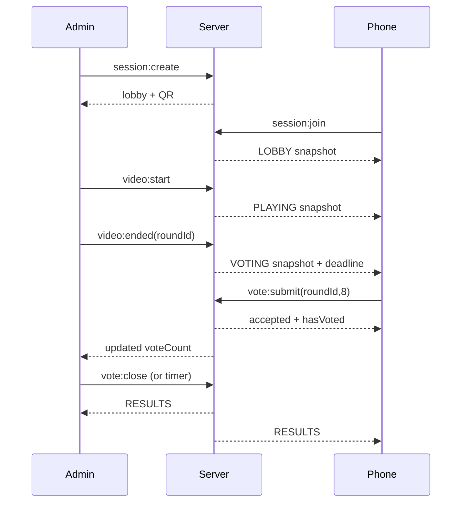

# 04 — Socket.IO protocol contract

Use one Socket.IO endpoint, same origin, default transport fallback. One authenticated admin socket and anonymous participant sockets. A socket is initially unjoined. Admin cookie determines eligibility for admin commands, never `role` supplied by client. Participants explicitly join by ID. Each command uses Socket.IO acknowledgment callback with timeout (e.g. 5 seconds). Do not send a second independent ack event for the same command. Server pushes named snapshot events. All errors are safe codes with Turkish UI mapping.

## Command payloads (client → server)

| Event | Role | Payload | Ack data on success |
|---|---|---|---|
| session:create | admin | {playlist:[{id,name,size,lastModified,duration}]} | {sessionId, state} |
| admin:resume | admin | {} | {state: snapshot or null} |
| session:join | participant | {sessionId, token} | {state: participantSnapshot} |
| video:start | admin | {sessionId} | {state} |
| video:ended | admin | {sessionId,roundId} | {state} |
| video:skip | admin | {sessionId,roundId} | {state} |
| vote:submit | participant | {sessionId,roundId,score} | {accepted:true, state} |
| vote:extend | admin | {sessionId,roundId} | {state} |
| vote:close | admin | {sessionId,roundId} | {state} |
| session:finish | admin | {sessionId} | {state} |
| session:close | admin | {sessionId} | {} |

Ack envelope: `{ok:true,...data}` or `{ok:false,code}` with optional current role-appropriate state. Validate exact expected shape, string limits, ID formats and numeric finiteness. Reject bad payload instead of throwing. Ignore extra fields or reject consistently. `duration` finite positive seconds; size nonnegative integer; lastModified nonnegative number; playlist 1–100 entries, unique valid IDs. Use bounded per-socket event throttling to avoid obvious floods; never count rejected votes as accepted. No arbitrary user-to-user messages.

## Server pushes

- `session:state`: full role-specific snapshot after any state change, including accepted vote and presence changes. At this event size sending snapshots is simpler than many patch event types. This replaces separate progress/result events; no duplicate sources of truth.
- `session:closed`: `{sessionId}`; participant disables controls and renders closed state.
- `admin:warning`: `{code:'BACKUP_FAILED'}`; only admin.
- `admin:revoked`: `{code:'UNAUTHORIZED'}` then disconnect.

Use session participant room for public state only; send private voted state per socket/token (or emit individually, fine for tens of phones). Never broadcast admin snapshot to participant room. On connection, admin requests resume; participant calls join. On reconnect, repeat the same flow and discard stale queued actions. Do not rely on Socket.IO automatic buffering for votes: only emit while connected, attach current round ID, and use ack timeout. Rejoining same socket replaces old membership cleanly; disconnect removes socket from token's set, deletes empty sets and broadcasts count. The token itself can be forgotten between rounds if no current votes require it; no persistent participant registry.

## Public snapshot example

```json
{
  "sessionId":"00000000-0000-4000-8000-000000000001",
  "revision":12,
  "phase":"VOTING",
  "serverNow":1790000000000,
  "roundId":"00000000-0000-4000-8000-000000000002",
  "roundNumber":4,
  "totalRounds":20,
  "endsAt":1790000015000,
  "connectedCount":42,
  "voteCount":34,
  "hasVoted":false,
  "result":null
}
```

Example IDs/time are illustrative. Use `roundId:null`, `roundNumber:0`, `endsAt:null` when absent. `hasVoted` is calculated from token and current round; never accept client's claim. `result` becomes available only after RESULTS (average/count/distribution/status, no filenames or raw scores). On LEADERBOARD phones only need finished state, no playlist. Admin snapshot includes playlist, currentIndex, currentRound fields, results, ordered leaderboard, joinUrl and QR image data URL (generated once per session). No Map/Set objects serialized directly. No secrets in either snapshot. Use revision to reject older snapshots of same session; equal revision may still carry current serverNow and voted status. Reset revision on different session. On admin recovery, reconcile media using playlist metadata.

## Error codes

UNAUTHORIZED, INVALID_PAYLOAD, INVALID_SESSION, SESSION_ACTIVE, INVALID_PHASE, STALE_ROUND, VOTE_CLOSED, ALREADY_VOTED, INVALID_SCORE, RATE_LIMITED, INTERNAL_ERROR. On ALREADY_VOTED render voted state; on stale/closed request refresh snapshot. On invalid session show closed/invalid page and stop aggressive reconnect/join loops. Acknowledge only after mutation is accepted; persistence does not delay votes. Avoid exposing internal exceptions or secrets.

## Typical sequence


